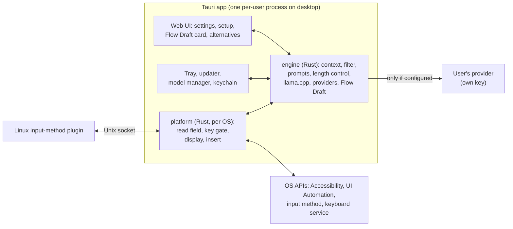
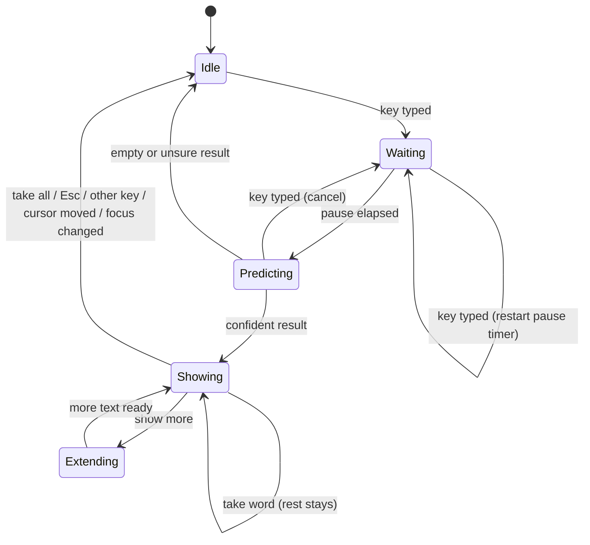
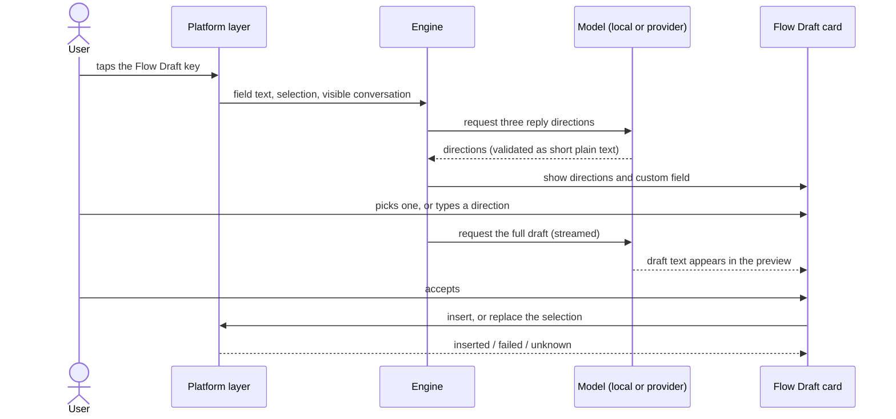

# open-flowtype architecture

Status: draft plan, 2026-10-30. Nothing here is implemented yet. The product behaviour this design must deliver is in [product.md](product.md).

## Overview

open-flowtype is one Tauri 2 application, written in Rust, built for each platform. The same Rust engine runs everywhere. A Rust module for each operating system reads text, catches keys, shows suggestions and inserts text. Tauri provides the windows, tray, settings interface, updater and packaging.

Three pieces need a little non-Rust code because the operating system requires it. Each is a thin shim that hands text to the Rust engine:

- the Android keyboard service, in Kotlin;
- the iOS keyboard extension, in Swift;
- the Linux input-method plugin.

## Planned repository layout

| Path | Contents |
| --- | --- |
| `crates/engine` | Prediction, length and boldness control, providers, Flow Draft, secret filter. No UI and no OS calls |
| `crates/platform` | Field reading, key gate, display and insertion for each OS, in modules compiled per platform |
| `crates/bench` | Replay benchmark |
| `app/` | Tauri application: windows, tray, updater, model manager, keychain access |
| `app/ui` | Web interface for settings, setup, the Flow Draft card and the alternatives menu |
| `linux-ime/` | Input-method plugin; its form is decided in the Linux spike |
| `mobile/android` | Keyboard service (Kotlin), packaged as a Tauri mobile plugin |
| `mobile/ios` | Keyboard extension (Swift), linking the engine as a static library |

## Process model

On the desktop, open-flowtype runs as one process per user: the Tauri app, started at login and living in the tray. It loads the model, the engine and the platform modules. It opens no network listening ports.

On Linux, the input-method plugin runs inside fcitx5 or IBus. It forwards field events to the app over a Unix socket in `$XDG_RUNTIME_DIR`, and accepts only connections from the same user, checked with `SO_PEERCRED`. The socket protocol is versioned, and a mismatch is reported to the user instead of failing silently. If the app is not running, the plugin passes every key through untouched.

On Android, the keyboard service process hosts the engine through JNI, by way of the Tauri mobile plugin. The Tauri app provides settings and setup.

On iOS, the keyboard extension links the engine as a static library built without llama.cpp, because extensions have too little memory for a local model. The container app is the Tauri app. Settings are shared through an App Group, and keys through a shared keychain access group.

## Platform layer

Each OS module provides the same capabilities to the engine:

| Capability | What it provides |
| --- | --- |
| Focus watch | Focus changes: app identity, app name, window title, field identity |
| Field read | Text before the cursor (capped), text after it (capped), the selection, the cursor rectangle in screen coordinates when known, the field kind (text, password, search, address, terminal, code, unknown), a font hint, and which reading method worked |
| Key gate | Decides immediately whether to consume a key, using a local copy of "a suggestion is showing" and the bound keys. It never waits on the engine |
| Display | Shows, updates and hides the suggestion: overlay, input-method text, card, or keyboard strip |
| Insert | Inserts text or replaces a range, and reports inserted, failed or unknown. The method is chosen per app: typed Unicode, paste with the clipboard restored, setting the value through accessibility, or an input-method commit |
| Conversation read | The visible messages, with sender where known, for Flow Draft |
| Status | Secure input, lost permission, blocked app |

How each platform provides them:

| | macOS | Windows | Linux | Android | iOS |
| --- | --- | --- | --- | --- | --- |
| Focus | AXObserver focus notifications and NSWorkspace app activation | UI Automation focus-changed events | Input-method focus-in and focus-out | `onStartInput` with `EditorInfo` (package name, input type) | Keyboard extension lifecycle |
| Field text and selection | AXUIElement value and selected range | UI Automation `TextPattern` / `TextPattern2` | Surrounding text and cursor from the input-method protocol (`text-input-v3` on Wayland, IM modules on X11) | `InputConnection.getTextBeforeCursor` / `getTextAfterCursor` / `getSelectedText` | `textDocumentProxy` context before and after input, selected text |
| Cursor position | Accessibility bounds for the cursor's range | UI Automation text range bounding rectangles | Known to the input method; the compositor places input-method popups | Not needed: the keyboard shows the suggestion | Not needed |
| Password fields | Secure text field role | `IsPassword` property | Content purpose `password` | Password input types | Secure text entry |
| Keys | `CGEventTap`. The callback must return fast, or macOS disables the tap | Low-level keyboard hook (`WH_KEYBOARD_LL`) | Keys arrive at the input method | The keyboard's own keys | The keyboard's own keys |
| Display | Non-activating, click-through `NSPanel` (Tauri window via [tauri-nspanel](https://github.com/ahkohd/tauri-nspanel)) | Topmost layered window that never activates and ignores the mouse | Input-method pre-edit text, or the input-method panel at the cursor | Suggestion strip | Suggestion strip |
| Insert | Unicode keyboard events, or paste with clipboard restore | `SendInput` Unicode, or paste with clipboard restore | Commit text and delete surrounding text | `commitText`, `setComposingText`, `deleteSurroundingText` | `insertText`, `deleteBackward` |
| Conversation | Accessibility tree of the window; Vision OCR fallback with Screen Recording permission | UI Automation tree; `Windows.Media.Ocr` fallback | AT-SPI over D-Bus; screenshot portal plus OCR fallback | Not available to keyboards | Not available to keyboards |
| Secure input / blocked | `IsSecureEventInputEnabled` | Elevated windows are unreachable (UIPI) | Password purpose | Password types | Secure fields use the system keyboard |

Linux uses the input-method route on both Wayland and X11, so there is one Linux code path. On Wayland it is the only route that works: ordinary windows cannot learn the cursor's position or place themselves next to it, and there is no global keyboard capture.

## Engine

### Suggestion lifecycle

Invariant: a suggestion is shown only if it was computed for the field's current text revision. Each request carries the field identity and text revision, and any result that no longer matches is dropped.

### Building a request

The prompt is assembled from segments, ordered from least to most frequently changing:

1. instructions;
2. about me;
3. style samples;
4. clipboard;
5. conversation;
6. text after the cursor;
7. text before the cursor.

Each segment has a character cap, and the total fits the model's context budget. The secret filter runs on every segment before a cloud provider sees it.

Models with fill-in-the-middle support get the text around the cursor in that format; the others get labelled text sections. Prompt templates are versioned files in the repository, reviewed like code, and every benchmark result records the template version it used.

### Length and boldness

The engine generates tokens until the length mode's boundary, plus one boundary unit of lookahead, or until a hard cap.

1. It finds the first token whose probability falls below the threshold set by the boldness slider. In Auto mode, that point is the cut.
2. It moves the cut back to the last boundary the mode allows (word, phrase, sentence or paragraph) and to the app's Auto ceiling.
3. It keeps the rest as a buffer, so "show more" and "take word" do not wait for a new request.

Without token probabilities, Auto cuts at the first sentence boundary, limited by the app's Auto ceiling. The local model always reports probabilities; for cloud providers it depends on the provider.

When the cursor is in the middle of a word, the local model backs off to the start of that word. It then allows only tokens that agree with the letters already typed, by setting a logit bias over the vocabulary. With a cloud provider, the request includes the partial word, and outputs that do not continue it are discarded.

### Local inference

open-flowtype runs [llama.cpp](https://github.com/ggml-org/llama.cpp) through Rust bindings, with the GPU backend each platform supports: Metal on macOS, Vulkan or CUDA on Windows and Linux, and CPU or Vulkan on Android.

- One model stays loaded. It is loaded on first use, with progress shown in the tray, and unloaded after a period of idleness the user can set.
- The KV cache is reused up to the first token that changed, and the segment order above keeps that point near the end.
- While the user types, a short debounce pre-reads the prompt into the cache, so a pause only has to generate.
- Cancellation is checked between tokens.
- If a decode fails, the context is recreated. If memory cannot be allocated, local inference reports itself unavailable instead of retrying in a loop.
- Alternatives copy the KV sequence and branch on the most likely first tokens.

At the 16 GB floor the standard model is about 3 GB.

Model files come from a curated manifest shipped inside the signed app. Each entry has the URL, size, SHA-256 and license. Downloads resume after interruption, and a file is used only after its hash matches.

### Cloud providers

Each provider adapter declares what it supports: streaming, token probabilities, raw completion as well as chat, fill-in-the-middle, and prompt caching. Planned adapters: OpenAI-compatible (chat and completions), Anthropic Messages, and Gemini.

- Autocomplete has at most one request in flight. A new keystroke cancels it, and the cancellation reaches the HTTP layer so the provider can stop. Autocomplete requests are never retried, because a late answer is useless.
- Flow Draft requests retry transient failures (rate limits, overload, transport errors) a bounded number of times, within an end-to-end deadline.
- A per-minute client limit always applies, and the user can add a daily cap.
- Keys are read from the OS keychain at call time. They never enter prompts or logs, and never appear in the "What was sent" view.

### Flow Draft

- Conversation text and model output are untrusted data. Output is validated as plain text and inserted only after the user accepts it.
- If the directions come back invalid, the request is retried once. If they are still invalid, the card asks the user to type a direction.
- If the insert result is unknown because the app did not confirm, the card says so and keeps the draft so it can be copied.

### Secret filter

The secret filter runs on everything that leaves the device and on everything stored in style memory. It removes:

- provider API keys and access tokens: `sk-`, `sk-ant-`, `AIza`, `ghp_` and `github_pat_`, Slack `xox*`, AWS `AKIA` and `ASIA`, JSON Web Tokens, bearer tokens;
- `password=` and `api_key=` style pairs;
- card numbers that pass a Luhn check.

It also respects clipboard markers that password managers set: `org.nspasteboard.ConcealedType` on macOS, `ExcludeClipboardContentFromMonitorProcessing` on Windows, and `x-kde-passwordManagerHint` on Linux. These markers come from published conventions and are checked during each platform phase.

### Storage

| Data | Where | Kept |
| --- | --- | --- |
| Settings and per-app rules | TOML file in the OS config directory, written atomically | Until changed |
| API keys | OS keychain, through the `keyring` crate | Until removed |
| Models | OS data directory | Until removed |
| Style memory (opt-in) | SQLite in the data directory | Most recent messages per app, up to a cap; can be viewed and deleted |
| Usage stats | SQLite in the data directory | Daily counts only, no text |
| "What was sent" log | Memory only | Cleared on quit |
| Diagnostic logs | The OS log location, size-limited | Never contain typed text |

### Updates and distribution

| Platform | Package | Updates |
| --- | --- | --- |
| Linux | deb, rpm, AUR; the input-method plugin installs alongside | Distribution package manager |
| macOS | Signed and notarized DMG | Tauri updater, signed |
| Windows | Signed MSI or NSIS installer | Tauri updater, signed |
| Android | APK, F-Droid; Google Play later | Store or F-Droid |
| iOS | TestFlight, then the App Store | App Store |

Flatpak is not planned for the first Linux release, because the input-method plugin and AT-SPI access have to live on the host.

## Security boundaries

- No network listener. The only local channel is the Linux plugin socket, with a same-user peer check.
- API keys stay in the OS keychain and are read at call time. They never go into prompts, logs or the "What was sent" view.
- Text from fields, screens, clipboards and conversations is data. It cannot trigger an action or change a setting.
- Text is inserted only after an explicit accept: an accept key for autocomplete, the accept button for Flow Draft. Nothing is ever sent.
- Model files are verified against SHA-256 hashes from the manifest inside the signed app. Updates are signed.
- Clean-room rule: no code, prompts, assets or model files are copied from closed-source products, and contributions derived from decompiling them are not accepted.

## Benchmark

`crates/bench` replays writing samples as typing. It pauses where real typists pause, asks the engine for a suggestion at each pause, and accepts the longest stretch of the suggestion that matches the real continuation, using the same word-by-word and whole-suggestion rules as the keys.

It reports:

- keystrokes saved;
- the shown-but-rejected rate;
- words accepted per suggestion;
- latency at the median and 95th percentile;
- for cloud providers, the cost per 1,000 words.

Runs cover every combination of model, prompt template version, length mode and boldness. Corpora are public text under suitable licenses, plus the user's own writing if they opt in; that writing stays on their machine.

The results set the defaults (boldness, curated models, Auto ceilings). The benchmark runs again before any change to a model, prompt template or stop rule ships.

## App checklist

Each platform keeps a list of about 20 apps across browser text boxes, chat, notes and documents, terminals, and email. Every app is checked for:

- reading the text;
- cursor placement;
- taking a word, taking all, and showing more;
- typing through a suggestion;
- clean insertion;
- one-step undo;
- Flow Draft insertion.

Results are recorded for each release. An app that fails placement gets the card fallback.

## Spikes before the full build

Each spike ends in a written result.

| Spike | Question | Done when |
| --- | --- | --- |
| Linux input method | On niri, can a plugin read surrounding text and show a suggestion inline (pre-edit) or in the panel? Can it identify the app for per-app rules? Do Chromium and Electron work with `--enable-wayland-ime`? | The display method and plugin form are chosen, with a list of apps that work |
| Overlay | On macOS and Windows, can a Tauri window be transparent, click-through and never take focus, sit at the cursor, and update within one frame? | A choice between a Tauri webview window and a natively drawn window |
| Engine | Latency and quality of the local model on a 16 GB machine; KV reuse; do the length cuts feel natural? | Measured latency against the targets in product.md |
| Benchmark | A first harness with one corpus | A report comparing at least two models |

## Build order

1. The engine and the benchmark come first, because every platform depends on them.
2. Platforms then follow: Linux, macOS, Windows, Android, iOS.
3. Each platform release includes autocomplete and Flow Draft.

## Decisions

| Date | Decision | Reason |
| --- | --- | --- |
| 2026-10-29 | MPL-2.0 license | Changes to our own files stay open; the code can be combined with Apache and MIT dependencies; compatible with App Store distribution |
| 2026-10-29 | Engine in Rust | One codebase for all targets, with direct use of llama.cpp's C API |
| 2026-10-30 | One Tauri 2 app with native Rust platform modules | One application on every platform, instead of a separate app per OS. Tauri provides windows, tray, updater and mobile targets |
| 2026-10-29 | Build order: Linux, macOS, Windows, Android, iOS | Linux is the maintainer's daily platform and has no comparable product |
| 2026-10-29 | First release on each platform includes autocomplete and Flow Draft | Both features from the start |
| 2026-10-30 | Defaults: Auto length; Tab, backtick, Alt+→; setup asks local or key; 16 GB local-model floor | See product.md |
| 2026-10-29 | Linux through the input method on X11 and Wayland | Wayland reveals the cursor and keys only to input methods; one code path for both |
| 2026-10-29 | Clean-room development | Avoids importing closed-source code or terms |

## Open technical decisions

- The Linux plugin's form: a fcitx5 add-on (a C++ shim calling into Rust), an IBus engine (Rust over D-Bus), or both. GNOME ships IBus; many other desktops use fcitx5.
- Display on Linux: pre-edit text (inline, but apps usually underline it and treat it as composing text) or the input-method panel next to the cursor.
- How to identify the app on Wayland for per-app rules.
- The llama.cpp binding: an existing crate or a thin binding of our own.
- The web framework for the Tauri windows.
- Overlay rendering: a Tauri webview window or a natively drawn window (overlay spike).
- OCR on Linux, which has no system OCR service.
- The curated local models (benchmark plus license review).
