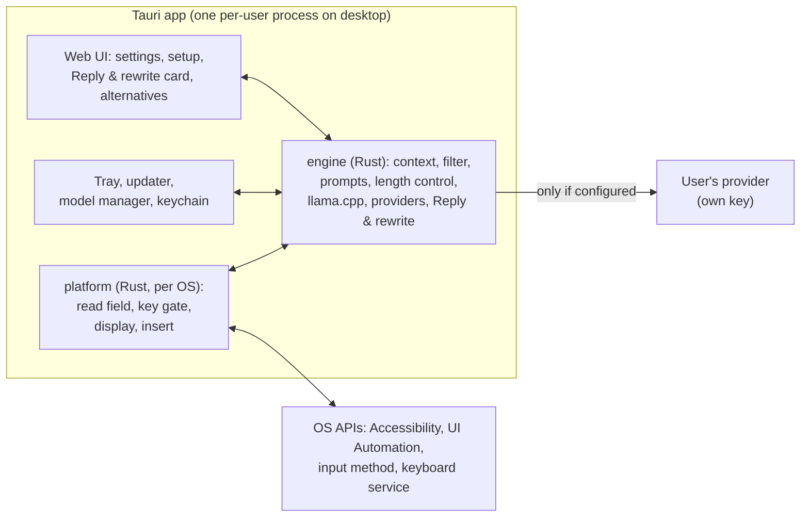
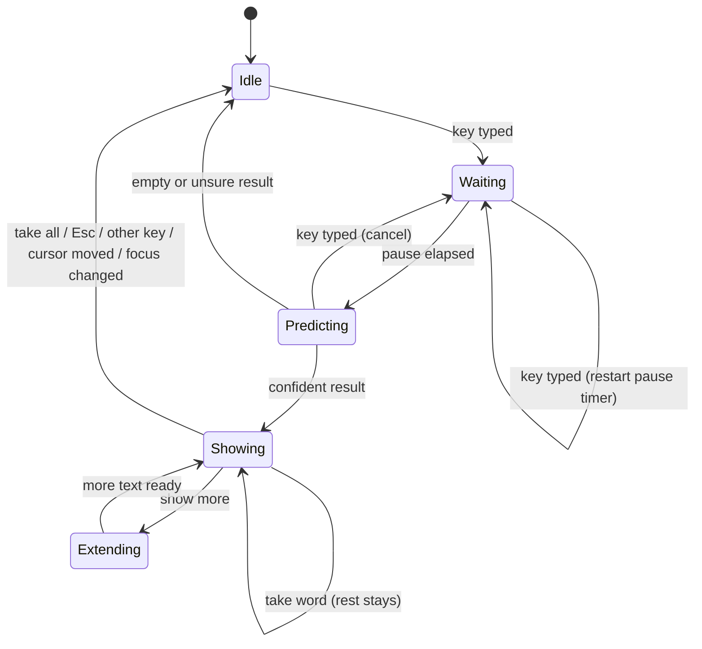
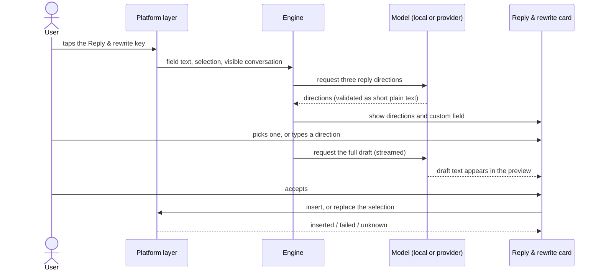

# Ghostcaret architecture

Status: in development, 2026-10-30. The workspace and the shared contracts exist; the components are being built. The product behaviour this design must deliver is in [product.md](product.md), and the measured targets it must meet are in [quality.md](quality.md).

## Overview

Ghostcaret is one Tauri 2 application, written in Rust, built for each platform. The same Rust engine runs everywhere. A Rust module for each operating system reads text, catches keys, shows suggestions and inserts text. Tauri provides the windows, tray, settings interface, updater and packaging.

Two pieces need a little non-Rust code because the operating system requires it. Each is a thin shim that hands text to the Rust engine:

- the Android keyboard service, in Kotlin;
- the iOS keyboard extension, in Swift.

## Repository layout

| Path | Contents |
| --- | --- |
| `crates/engine` | The contracts every backend and model provider implements; settings; text units, stop rules, prompts, secret filter; the controller state machine. No UI, no OS calls, no model code |
| `crates/local` | Local inference through llama.cpp, and the model store (manifest, verified downloads) |
| `crates/cloud` | Providers for the user's own key (OpenAI-compatible, Anthropic, Gemini) and the "What was sent" log |
| `crates/platform` | Field reading, key gate, display and insertion for each OS, in modules compiled per platform |
| `crates/render` | Software renderer for the suggestion panel and the Reply & rewrite card, shared by the Linux and Windows overlays |
| `crates/bench` | Replay benchmark |
| `app/` | Tauri application: runtime, tray, settings, setup, model manager, keychain access |
| `app/ui` | Web interface for settings and setup |
| `mobile/android` | Keyboard service (Kotlin) and its test harness, moved into the Tauri Android project once integrated |
| `mobile/ios` | Keyboard extension (Swift), linking the engine as a static library |

The engine never depends on model or OS code. The controller in `crates/engine` is a pure state machine: the app runtime feeds it backend events, model results and timer expiries, and executes the outputs it returns. Every product rule therefore lives in one place and is tested without an OS or a model.

## Process model

On the desktop, Ghostcaret runs as one process per user: the Tauri app, started at login and living in the tray. It loads the model, the engine and the platform modules. It opens no network listening ports.

On Linux, the app itself is the input method. It speaks the Wayland input-method protocol (`zwp_input_method_v2`) from a dedicated thread on its own Wayland connection, so no fcitx5 or IBus plugin and no socket are involved. While a text field is active it holds a keyboard grab, handles bound keys, and forwards every other key unchanged through a virtual keyboard (`zwp_virtual_keyboard_v1`). If the app exits or crashes, the compositor drops the grab and typing continues without it.

On Android, the keyboard service hosts the engine through JNI. The engine runs in the keyboard's process; the Tauri app in the same APK provides settings and setup.

On iOS, the keyboard extension links the engine as a static library built without llama.cpp, because extensions have too little memory for a local model. The container app is the Tauri app. Settings are shared through an App Group, and keys through a shared keychain access group.

## Platform layer

Each OS module provides the same capabilities to the engine:

| Capability | What it provides |
| --- | --- |
| Focus watch | Focus changes: app identity, app name, window title, field identity |
| Field read | Text before the cursor (capped), text after it (capped), the selection, the cursor rectangle in screen coordinates when known, the field kind (text, password, search, address, terminal, code, unknown), a font hint, and which reading method worked |
| Key gate | Decides immediately whether to consume a key, using a local copy of "a suggestion is showing" and the bound keys. It never waits on the engine |
| Display | Shows, updates and hides the suggestion: overlay, input-method text, card, or keyboard strip |
| Insert | Inserts text or replaces a range, and reports inserted, failed or unknown. The method is chosen per app: typed Unicode, paste with the clipboard restored, setting the value through accessibility, or an input-method commit |
| Conversation read | The visible messages, with sender where known, for Reply & rewrite |
| Status | Secure input, lost permission, blocked app |

How each platform provides them:

| | macOS | Windows | Linux (Wayland) | Android | iOS |
| --- | --- | --- | --- | --- | --- |
| Focus | AXObserver focus notifications and NSWorkspace app activation | UI Automation focus-changed events | Input-method `activate` and `deactivate`; app id and title of the active window from `zwlr_foreign_toplevel_manager_v1` | `onStartInput` with `EditorInfo` (package name, input type) | Keyboard extension lifecycle |
| Field text and selection | AXUIElement value and selected range | UI Automation `TextPattern` / `TextPattern2` | `surrounding_text` (UTF-8, cursor and anchor) from the input-method protocol | `InputConnection.getTextBeforeCursor` / `getTextAfterCursor` / `getSelectedText` | `textDocumentProxy` context before and after input, selected text |
| Cursor position | Accessibility bounds for the cursor's range | UI Automation text range bounding rectangles | Known to the compositor, which places the input-method popup and reports the cursor rectangle relative to it | Not needed: the keyboard shows the suggestion | Not needed |
| Password fields | Secure text field role | `IsPassword` property | Content purpose `password` or `pin` | Password input types | Secure text entry |
| Keys | `CGEventTap`. The callback must return fast, or macOS disables the tap | Low-level keyboard hook (`WH_KEYBOARD_LL`) | Input-method keyboard grab; unconsumed keys forwarded through a virtual keyboard | The keyboard's own keys | The keyboard's own keys |
| Display | Non-activating, click-through `NSPanel` (Tauri window via [tauri-nspanel](https://github.com/ahkohd/tauri-nspanel)) | Topmost layered window that never activates and ignores the mouse, drawn by `crates/render` | Input-method popup surface at the cursor, drawn by `crates/render` | Suggestion strip | Suggestion strip |
| Insert | Unicode keyboard events, or paste with clipboard restore | `SendInput` Unicode, or paste with clipboard restore | `delete_surrounding_text` and `commit_string` | `commitText`, `setComposingText`, `deleteSurroundingText` | `insertText`, `deleteBackward` |
| Conversation | Accessibility tree of the window; Vision OCR fallback with Screen Recording permission | UI Automation tree; `Windows.Media.Ocr` fallback | AT-SPI over D-Bus; screenshot portal plus OCR fallback | Not available to keyboards | Not available to keyboards |
| Secure input / blocked | `IsSecureEventInputEnabled` | Elevated windows are unreachable (UIPI) | Password purpose | Password types | Secure fields use the system keyboard |

On Wayland the input-method route is the only one that works: ordinary windows cannot learn the cursor's position or place themselves next to it, and there is no global keyboard capture. `zwp_input_method_v2` is offered by niri, sway, Hyprland, river, labwc and other wlroots- and Smithay-based compositors. Only one input method can be bound at a time, so Ghostcaret cannot run alongside fcitx5 or IBus. KDE Plasma (which offers `zwp_input_method_v1`), GNOME (which uses IBus over D-Bus) and X11 sessions need their own adapters; see the open decisions.

## Engine

### Suggestion lifecycle

Invariant: a suggestion is shown only if it was computed for the field's current text revision. Each request carries the field identity and text revision, and any result that no longer matches is dropped.

### Building a request

The prompt is assembled from segments, ordered from least to most frequently changing:

1. instructions;
2. about me;
3. style samples;
4. clipboard;
5. conversation;
6. text after the cursor;
7. text before the cursor.

Each segment has a character cap, and the total fits the model's context budget. The secret filter runs on every segment before a cloud provider sees it.

Models with fill-in-the-middle support get the text around the cursor in that format; the others get labelled text sections. Prompt templates are versioned files in the repository, reviewed like code, and every benchmark result records the template version it used.

### Length and boldness

The engine generates tokens until the length mode's boundary, plus one boundary unit of lookahead, or until a hard cap.

1. It finds the first token whose probability falls below the threshold set by the boldness slider. In Auto mode, that point is the cut.
2. It moves the cut back to the last boundary the mode allows (word, phrase, sentence or paragraph) and to the app's Auto ceiling.
3. It keeps the rest as a buffer, so "show more" and "take word" do not wait for a new request.

Without token probabilities, Auto cuts at the first sentence boundary, limited by the app's Auto ceiling. The local model always reports probabilities; for cloud providers it depends on the provider.

When the cursor is in the middle of a word, the local model backs off to the start of that word. It then allows only tokens that agree with the letters already typed, by setting a logit bias over the vocabulary. With a cloud provider, the request includes the partial word, and outputs that do not continue it are discarded.

### Local inference

Ghostcaret runs [llama.cpp](https://github.com/ggml-org/llama.cpp) through Rust bindings, with the GPU backend each platform supports: Metal on macOS, Vulkan or CUDA on Windows and Linux, and CPU or Vulkan on Android. The CPU code path is chosen at run time for the processor's instruction set, so one build runs at full speed on every machine.

These are used from the start:

- One model stays loaded. It is memory-mapped, so loading is fast and the OS can page it. It is loaded on first use, with progress in the tray, and unloaded after a period of idleness the user can set, or when the OS reports memory pressure.
- The KV cache is reused up to the first token that changed, and the segment order above keeps that point near the end. A keystroke decodes only the new tokens.
- While the user types, a short debounce pre-reads the prompt into the cache, so a pause only has to generate.
- Generation stops at the length mode's boundary plus the lookahead. No token is generated that could never be shown. Cancellation is checked between tokens.
- Flash attention is enabled wherever the backend supports it.
- Each model uses the smallest weight quantization that loses no keystroke savings on the benchmark.
- Alternatives are decoded as parallel sequences in one batch, after copying the KV sequence, so three alternatives cost little more than one.
- If a decode fails, the context is recreated. If memory cannot be allocated, local inference reports itself unavailable instead of retrying in a loop.

These are measured in the engine spike, and adopted only where the benchmark shows a gain with no loss of quality:

- Speculative decoding. llama.cpp offers [several kinds](https://github.com/ggml-org/llama.cpp/blob/master/docs/speculative.md): n-gram drafting from the context, a small draft model, and EAGLE-3. N-gram drafting costs almost nothing and suits text that repeats words from the conversation.
- A quantized KV cache (the `type_k` and `type_v` context parameters, marked experimental in `llama.h`).
- Context length, thread count, and placement on performance or efficiency cores, per platform.
- Saving the cache for the stable segments to disk, so that a restart begins warm.

Base models, rather than chat-tuned ones, are the first candidates, because the task is continuing the user's own text; the benchmark also tests chat models to confirm this. The first shortlist, all Apache-2.0: [Qwen3.5 Base](https://huggingface.co/Qwen/Qwen3.5-2B-Base) at 0.8B, 2B and 4B, and [Gemma 4](https://huggingface.co/google/gemma-4-E4B) E2B and E4B. The benchmark picks the small and the standard model. At the 16 GB floor the standard model is about 3 GB.

Model files come from a curated manifest shipped inside the signed app. Each entry has the URL, size, SHA-256 and license. Downloads resume after interruption, and a file is used only after its hash matches.

### Cloud providers

Each provider adapter declares what it supports: streaming, token probabilities, raw completion as well as chat, fill-in-the-middle, and prompt caching. Planned adapters: OpenAI-compatible (chat and completions), Anthropic Messages, and Gemini.

- Autocomplete has at most one request in flight. A new keystroke cancels it, and the cancellation reaches the HTTP layer so the provider can stop. Autocomplete requests are never retried, because a late answer is useless.
- Reply & rewrite requests retry transient failures (rate limits, overload, transport errors) a bounded number of times, within an end-to-end deadline.
- A per-minute client limit always applies in the provider; the app runtime enforces the user's daily cap and keeps its count across restarts.
- Keys are read from the OS keychain when the provider is built, and the provider is rebuilt when the key or provider settings change. They never enter prompts or logs, and never appear in the "What was sent" view. A key is refused over plain `http://` unless the host is loopback or on the local network, and redirects are never followed.
- Each provider learns what the endpoint supports from its rejections: an OpenAI-compatible server without `/completions` falls back to chat, and a parameter the model rejects (log probabilities, temperature, output-limit field, reasoning effort) is dropped for later requests. Each lesson costs one extra request.
- Cloud providers return only the main candidate; alternatives come from the local model.
- When a text field gets focus, the HTTPS connection to the provider is opened and kept alive, so the first request skips the connection handshake.
- Requests ask for token probabilities where the provider offers them, and set the output limit from the length mode, so no tokens are paid for that cannot be shown.
- The stable-first segment order also matches how provider prompt caches work, so repeated requests reuse the cached prefix where the provider supports it.

### Reply & rewrite

- Conversation text and model output are untrusted data. Output is validated as plain text and inserted only after the user accepts it.
- If the directions come back invalid, the request is retried once. If they are still invalid, the card asks the user to type a direction.
- If the insert result is unknown because the app did not confirm, the card says so and keeps the draft so it can be copied.

### Secret filter

The secret filter runs on everything that leaves the device and on everything stored in style memory. It removes:

- provider API keys and access tokens: `sk-`, `sk-ant-`, `AIza`, `ghp_` and `github_pat_`, Slack `xox*`, AWS `AKIA` and `ASIA`, JSON Web Tokens, bearer tokens;
- `password=` and `api_key=` style pairs;
- card numbers that pass a Luhn check.

It also respects clipboard markers that password managers set: `org.nspasteboard.ConcealedType` on macOS, `ExcludeClipboardContentFromMonitorProcessing` on Windows, and `x-kde-passwordManagerHint` on Linux. These markers come from published conventions and are checked during each platform phase.

### Storage

| Data | Where | Kept |
| --- | --- | --- |
| Settings and per-app rules | TOML file in the OS config directory, written atomically | Until changed |
| API keys | OS keychain, through the `keyring` crate | Until removed |
| Models | OS data directory | Until removed |
| Style memory (opt-in) | SQLite in the data directory | Most recent messages per app, up to a cap; can be viewed and deleted |
| Usage stats | SQLite in the data directory | Daily counts only, no text |
| "What was sent" log | Memory only | Cleared on quit |
| Diagnostic logs | The OS log location, size-limited | Never contain typed text |

### Updates and distribution

| Platform | Package | Updates |
| --- | --- | --- |
| Linux | deb, rpm, AUR | Distribution package manager |
| macOS | Signed and notarized DMG | Tauri updater, signed |
| Windows | Signed MSI or NSIS installer | Tauri updater, signed |
| Android | APK, F-Droid; Google Play later | Store or F-Droid |
| iOS | TestFlight, then the App Store | App Store |

Flatpak is not planned for the first Linux release, because the input method needs the host's Wayland input-method protocol and AT-SPI access.

## Performance design

The targets in [quality.md](quality.md) shape the design in these ways.

The keystroke path stays minimal. The key gate reads a small state (is a suggestion showing, which keys are bound) from atomics, decides, and returns. It never allocates, locks, logs, or waits on the engine. Everything else happens on other threads after the key has been passed on or consumed.

Integration with the OS is driven by events. Focus, value and selection changes arrive as OS notifications; nothing polls on a timer. Element handles are cached per focused field. Text is re-read only when a notification or a keystroke says it changed, and the edit is applied to the cached copy where the platform reports ranges. Offsets are converted between the platform's units (UTF-16 on macOS, Windows, Android and iOS) and UTF-8 once, at the boundary.

Rendering does as little as possible. The suggestion window is created once and reused. An update changes only its text and position, and lands within one frame. There is no animation by default, which also respects reduced-motion settings.

Work runs only while the user types. Prediction starts after a keystroke and stops at the boundary or at the next keystroke. When the user is not typing, Ghostcaret has no running timers, and its process sleeps until the OS wakes it.

Memory follows the OS. The model unloads on memory-pressure signals (macOS memory pressure, Android `onTrimMemory`, Windows low-memory notifications) and when idle. Settings and setup windows release their web views when closed.

On battery, an optional low-power mode switches to the small model and a longer pause before predicting.

Release builds use link-time optimization and a single codegen unit, and strip symbols into separate debug files.

Each request records stage timings in release builds: read, filter, build, decode, render. They are cheap to collect, appear in the debug view, and can be exported for bug reports. They never leave the machine on their own.

## Security boundaries

- No network listener and no local socket.
- API keys stay in the OS keychain and are loaded only to build the provider. They never go into prompts, logs or the "What was sent" view.
- Text from fields, screens, clipboards and conversations is data. It cannot trigger an action or change a setting.
- Text is inserted only after an explicit accept: an accept key for autocomplete, the accept button for Reply & rewrite. Nothing is ever sent.
- Model files are verified against SHA-256 hashes from the manifest inside the signed app. Updates are signed.
- Clean-room rule: no code, prompts, assets or model files are copied from closed-source products, and contributions derived from decompiling them are not accepted.

## Verification

The benchmark (`crates/bench`), the app checklist, the parity floor and the release gates are defined in [quality.md](quality.md).

## Spikes before the full build

Each spike ends in a written result.

| Spike | Question | Done when |
| --- | --- | --- |
| Linux input method | Does a native `zwp_input_method_v2` client work on niri: grab and forwarding, surrounding text, popup placement at the cursor, app identity? Which apps work, and do Chromium and Electron work with `--enable-wayland-ime`? What does forwarding add per keystroke? | A list of apps that work, popup placement measured, gate time within the key-path budget |
| Overlay | On Windows (and later macOS), does a natively drawn layered window sit at the cursor, update within one frame, and stay inside the memory budget? | Measured placement and frame time |
| Engine | Latency, memory and keystroke savings of the shortlisted models on the reference machines; KV reuse; whether the length cuts feel natural; each technique under evaluation | Measured results against [quality.md](quality.md), and a decision on each technique |
| Benchmark | A first harness with one corpus | A report comparing every shortlisted model |

## Build order

1. The engine and the benchmark come first, because every platform depends on them.
2. Platforms: Linux first, with Windows and Android built alongside it; macOS and iOS follow once there is hardware to test on.
3. Each platform release includes autocomplete and Reply & rewrite.

## Decisions

| Date | Decision | Reason |
| --- | --- | --- |
| 2026-10-29 | MPL-2.0 license | Changes to our own files stay open; the code can be combined with Apache and MIT dependencies; compatible with App Store distribution |
| 2026-10-29 | Engine in Rust | One codebase for all targets, with direct use of llama.cpp's C API |
| 2026-10-30 | One Tauri 2 app with native Rust platform modules | One application on every platform, instead of a separate app per OS. Tauri provides windows, tray, updater and mobile targets |
| 2026-10-30 | Build order: Linux first, Windows and Android alongside, macOS and iOS later | Linux is the maintainer's daily platform and has no comparable product; Windows and Android have test machines now, macOS and iOS do not |
| 2026-10-29 | First release on each platform includes autocomplete and Reply & rewrite | Both features from the start |
| 2026-10-30 | Defaults: Auto length; Tab, backtick, Alt+→; setup asks local or key; 16 GB local-model floor | See product.md |
| 2026-10-29 | Linux through the input method | Wayland reveals the cursor and keys only to input methods |
| 2026-10-30 | On Wayland, the app is the input method itself (`zwp_input_method_v2`), with no fcitx5 or IBus plugin | All Rust, no socket or second process, nothing to install system-wide; niri and other wlroots- and Smithay-based compositors support it |
| 2026-10-30 | Engine split into `engine` (logic and contracts), `local`, `cloud`; overlay drawn by `crates/render` on Linux and Windows | The engine stays free of model and OS code; one renderer serves both overlays |
| 2026-10-30 | Android ships its own keyboard inside the APK | Keyboards are the only Android component that can insert text everywhere without the accessibility API |
| 2026-10-29 | Clean-room development | Avoids importing closed-source code or terms |
| 2026-10-30 | Measured release gates in quality.md: latency, resource use, suggestion quality, parity floor | Best in class is a measured claim; nothing ships below the bar |

## Open technical decisions

- Adapters for KDE Plasma (`zwp_input_method_v1`), GNOME (IBus engine over D-Bus) and X11 sessions.
- Living alongside a user's CJK input method on Linux, since only one input method can be bound.
- The llama.cpp binding: an existing crate or a thin binding of our own (being decided in the engine work).
- OCR on Linux, which has no system OCR service.
- The curated local models (benchmark plus license review).
